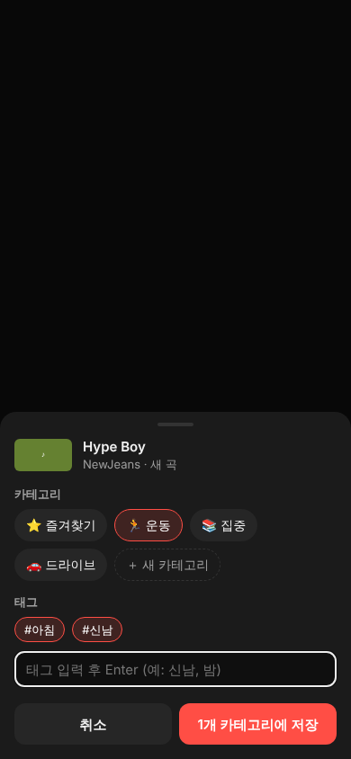
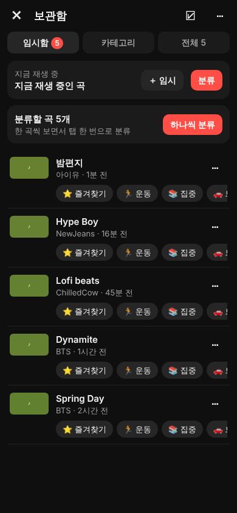
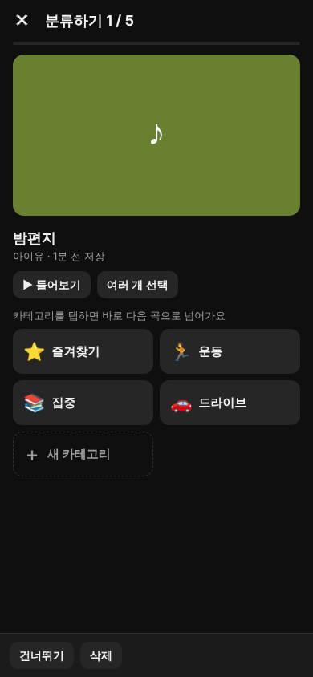
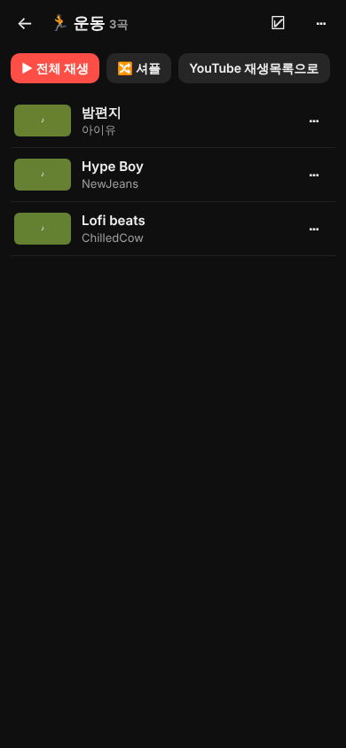

# 기능: 빠른 저장 → 나중에 분류 (임시함 · 카테고리 · 태그)

> 문서 목록: [README](README.md) · [작업 로그](LOG.md) · [전체 개요](OVERVIEW.md)

작성일: 2026-11-03 · 상태: **구현 완료(공용 UI·로직 테스트 18/18), 실기기 미검증**

---

## 1. 요구사항 (사용자 요청 원문 요약)

- 지금 재생 중인 곡을 **아주 쉽게** 플레이리스트에 넣는 버튼을 **상단에** 둔다.
- 버튼은 2개다.
  - ① **임시 플레이리스트로 저장**
  - ② **카테고리(플레이리스트 종류)를 골라서 분류 저장**
- 임시로 저장한 곡은 **나중에 카테고리나 태그를 달아 분류**할 수 있어야 하고, 그 작업을 쉽게 할 수 있는 UI가 따로 있어야 한다.
- 목적: **일단 빨리 저장해 두고, 분류는 나중에.**

## 2. 연구: 다른 앱들은 어떻게 하나

자세한 내용과 출처는 [CASE_STUDIES.md §4](CASE_STUDIES.md#4-part-b-저장정리-ux-패턴과-bgplay-권고)에 있다.

| 패턴 | 사례 | BgPlay 적용 |
|---|---|---|
| 원탭 저장 → 저장 위치를 알려주는 스낵바 → "변경" 버튼 | YouTube, YouTube Music, Spotify | ✅ "＋ 임시" 탭 → 스낵바 "임시함에 저장했어요 · **분류**" |
| 길게 누르면 상세 선택 | (일반 관례) | ✅ "＋ 임시"를 길게 누르면 분류 시트가 바로 열림 |
| 최근 사용(MRU) 목록 우선 | YouTube Music(최근 5개), Metrolist(최근 수정순) | ✅ 카테고리 칩·버튼을 최근 사용 순으로 정렬 |
| 이미 담긴 곳 표시 | NewPipe(회색 처리) | ✅ 분류 시트에서 이미 속한 카테고리는 선택된 상태로 표시. 상단 정보에 "운동 · 집중에 있음" |
| 중복 판정은 URL 정규화 키로 | NouTube(host+videoId) | ✅ 영상 ID(11자) 기준. youtu.be, shorts, live, music 링크가 모두 같은 곡 |
| 짧은 되돌리기 토스트 | NouTube(5초 undo) | ✅ 4초 토스트 "되돌리기"(분류, 이동, 삭제, 카테고리 삭제 모두) |
| 수집과 정리 분리, 인박스는 비우는 곳 | GTD, Todoist Inbox | ✅ "임시함" + 개수 배지 + "하나씩 분류" 모드 |
| 폴더(단일) vs 라벨(다중) | Todoist(프로젝트 1개 + 라벨 여러 개) | 🔶 **카테고리 여러 개 + 태그 여러 개**로 결정([DECISIONS.md D-07](DECISIONS.md)) |
| 다중 선택 일괄 처리 | NewPipe, 일반 관례 | ✅ 길게 눌러 선택 → 분류 / 빼기 / 삭제 |
| 내보내기·백업 | NewPipe, Metrolist, Pocket 종료의 교훈 | ✅ JSON 내보내기(공유 시트)와 가져오기(합치기/덮어쓰기) |
| 알림·잠금화면에서 저장 | (권고) | ✅ Android 알림 + Android 13 이상 미디어 컨트롤의 "임시 저장" 버튼. iOS는 다음 단계 |

## 3. 사용 흐름

### 3.1 저장 (재생 중, 상단 바)

```
[YouTube] [Music]          [＋ 임시] [분류] [보관함 3] [⋮]      ← Android 상단 바
BgPlay                     ＋ 임시   분류   보관함 3            ← iOS 상단 바
```

| 동작 | 결과 |
|---|---|
| **＋ 임시** 탭 | 결정 없이 임시함에 저장 → 스낵바 "임시함에 저장했어요 · [분류]" |
| 이미 저장된 곡에서 **＋ 임시** | 아무것도 바꾸지 않고 "이미 저장됨 · 운동, 집중" 또는 "이미 임시함에 있어요" · [분류] |
| **＋ 임시** 길게 누르기 / **분류** 탭 | 분류 시트: 카테고리 칩(여러 개 선택) + 태그 칩/입력 + "지난번처럼" + 새 카테고리 즉석 생성 |
| 알림 / 잠금화면(Android)의 "임시 저장" | 앱을 열지 않고 임시함에 저장. 앱이 꺼져 있으면 대기열에 쌓였다가 다음 실행 때 반영 |



### 3.2 정리 (보관함)

- **임시함 탭**
  - 맨 위에 "지금 재생 중"(아직 저장 안 했으면)과 "분류할 곡 N개 · [하나씩 분류]"가 있다.
  - 각 곡 아래에는 최근 카테고리 4개가 칩으로 있어서 **한 번 탭하면 그 카테고리로 이동**한다. "분류…"를 누르면 시트가 열린다.
  - 길게 누르면 다중 선택으로 들어가 일괄 분류나 삭제를 할 수 있다.
- **하나씩 분류(트리아지)**
  - 큰 썸네일과 제목을 보여주고, 아래에 카테고리 버튼 격자가 있다. **탭 한 번에 분류하고 다음 곡으로** 넘어간다.
  - "여러 개 선택" 모드에서는 카테고리를 여러 개 고른 뒤 "확인 → 다음"을 누른다.
  - 태그 칩은 함께 붙인다. 건너뛰기, 삭제, ↶ 되돌리기, ▶ 들어보기를 쓸 수 있다.
- **카테고리 탭**: 카테고리별 곡 수와 ▶ 전체 재생 버튼이 있다. 상세 화면에서는 전체 재생, 셔플, 태그 필터, 곡별 메뉴(맨 위로, 빼기, 삭제), 이름·아이콘 변경, 카테고리 삭제를 할 수 있다.
- **전체 탭**: 검색(제목, 아티스트, 태그)과 태그 필터.

| 임시함 | 하나씩 분류 | 카테고리 상세 |
|---|---|---|
|  |  |  |

> 스크린샷은 헤드리스 Chromium(390×844)에서 자동 테스트 중에 찍은 것이다. 썸네일은 테스트용 단색 이미지다. 실제 앱에서는 분류 시트 뒤로 재생 중인 YouTube 화면이 비친다.

### 3.3 재생

- 보관함에서 곡을 탭하면 그 곡을 재생한다.
- 카테고리 상세에서 곡을 탭하면 **그 위치부터 카테고리 전체를 큐로** 재생한다.
- 큐 재생 중의 동작:
  - 곡이 끝나면(`ended`) 앱이 다음 곡을 연다.
  - 알림, 잠금화면, 이어폰의 다음/이전 버튼은 큐를 따라간다.
  - 사용자가 다른 영상으로 이동하면 큐가 끝난다.
- "YouTube 재생목록으로": 최대 50곡을 `watch_videos?video_ids=…`(비공식 URL)로 열어 YouTube 자체 큐로 재생한다. 동작 여부는 미검증이다.

## 4. 데이터 모델

```jsonc
{
  "v": 1,
  "items": {                     // 영상 ID → 곡 (중복 없음)
    "dQw4w9WgXcQ": {
      "videoId": "dQw4w9WgXcQ", "source": "music",      // music.youtube.com 에서 저장했으면 music
      "title": "…", "artist": "…", "thumb": "https://…", "duration": 213,
      "addedAt": 1793750400000, "tags": ["신남", "아침"]
    }
  },
  "categories": [               // 카테고리 = 순서 있는 플레이리스트
    { "id": "c_default_1", "name": "운동", "emoji": "🏃", "createdAt": 0, "lastUsedAt": 1793750400000,
      "items": ["dQw4w9WgXcQ"] }
  ],
  "prefs": { "lastSelection": { "categoryIds": ["c_default_1"], "tags": ["신남"] } }
}
```

- **임시함은 따로 저장하지 않는다.** "어느 카테고리에도 없는 곡"을 계산한다. 그래서 분류하면 저절로 임시함에서 빠지고, 카테고리를 지우면 그 곡은 저절로 임시함으로 돌아온다.
- 기본 카테고리 4개를 미리 둔다: ⭐ 즐겨찾기, 🏃 운동, 📚 집중, 🚗 드라이브. 처음부터 탭 한 번으로 분류할 수 있게 하려는 것이고, 지우거나 이름을 바꿀 수 있다.
- 태그는 소문자로 바꾸고 `#`과 중복을 없앤다. 최대 30자다.
- 저장 위치는 Android `filesDir/library.json`(AtomicFile), iOS `Application Support/library.json`(atomic write)이다.

## 5. 구현 구조

```
shared/web/library/          ← Android·iOS가 같은 파일을 번들에 넣어 씀
  core.js    데이터 로직 (순수 함수, Node에서 단위 테스트)
  ui.js      화면 (분류 시트, 임시함, 하나씩 분류, 카테고리, 전체, 토스트, 되돌리기)
  style.css  모바일 다크 테마, safe-area 대응
  index.html

Android  LibraryController.kt  투명 WebView 오버레이 (WebViewAssetLoader: https://appassets.androidplatform.net/assets/library/)
         LibraryStore.kt       JSON 원자 저장 + 백그라운드 저장 대기열(pending)
         MainActivity.kt       상단 바(＋ 임시 / 분류 / 보관함 N / ⋮), 스낵바, 내보내기 공유
         PlayerController.kt   currentTrack(), 큐(playQueue/skipNext/advanceQueue), 알림에서 저장
         PlaybackService.kt    알림 액션 + MediaSession custom action "임시 저장"
iOS      LibraryOverlay.swift  투명 WKWebView 오버레이 (번들 library/index.html)
         LibraryStore.swift    JSON 원자 저장
         SnackBar.swift        스낵바
         PlayerViewController  상단 바, currentTrack(), 큐, 잠금화면 다음/이전 → 큐
```

**브리지 프로토콜**

| 방향 | 메시지 |
|---|---|
| 네이티브 → 페이지 | `__bglib.boot(json)`, `quickSave(track)` → `{status, title, where[], inbox}`, `openSave(track)`, `openLibrary()`, `nowPlaying(track)`, `back()` |
| 페이지 → 네이티브 | `ready`, `persist{data}`, `stats{inbox,total}`, `close`, `play{url,keepOpen}`, `playQueue{name,items,index}`, `toast{text}`, `export{json,filename}` |

`track` 형식은 `{url, title, artist, artwork, duration}`이다. 네이티브는 이미 MediaSession용으로 받고 있던 재생 정보를 그대로 넘긴다.

**왜 UI를 웹으로 공유하나?** 이유와 대안은 [DECISIONS.md D-06](DECISIONS.md)에 있다. 요약하면 두 플랫폼에서 같은 UX를 내면서 코드를 한 벌로 유지할 수 있고, 이 개발 환경(Android SDK/Xcode 없음)에서 **실제로 테스트할 수 있는 유일한 방법**이기 때문이다.

## 6. 테스트

`node bgplay/shared/test/library.test.mjs`: core 7개 + UI 11개 = **18/18 통과**

- core: URL 파싱(watch/music/youtu.be/shorts/live/타 도메인), 임시 저장과 중복, 분류(추가/이동), 태그 정규화, MRU, 카테고리 중복 이름, 삭제 시 임시함 복귀, 깨진 데이터 복구, 큐/셔플, 내보내기와 가져오기
- UI(Chromium 390×844, 터치): 상단 ＋ 결과와 저장/배지 메시지, 분류 시트(선택, 태그 입력, 소속 편집, "지난번처럼"), 시트 안 새 카테고리, 임시함 빠른 이동과 되돌리기, 하나씩 분류 전체 흐름, 길게 눌러 다중 선택 일괄 분류, 카테고리 큐 재생, 카테고리 삭제와 되돌리기, 검색과 태그 필터, 뒤로 가기 순서, XSS 이스케이프

## 7. 아직 안 한 것 / 다음 단계

| 항목 | 근거 | 우선순위 |
|---|---|---|
| 실기기 검증 ([TEST_PLAN.md §2](TEST_PLAN.md)) | 오버레이 터치, 키보드, 백그라운드 큐 진행 | 높음 |
| 백그라운드 큐 진행 보강: 끝나기 몇 초 전 미리 다음 곡 열기, 재시도 | FixYTBackground pre-advance. Brave에서 "YT Music 백그라운드 다음 곡 안 넘어감" 버그 보고 | 높음 (특히 iOS) |
| iOS 잠금화면 저장(`bookmarkCommand`), Share Extension | CASE_STUDIES §4.3-A | 중간 |
| 중복 저장 시 `saveCount`와 저장 시각 갱신(관심도 신호) | CASE_STUDIES §4.3-C | 낮음 |
| 저장 시점 재생 위치 기억 → "하나씩 분류"에서 그 위치부터 미리 듣기 | CASE_STUDIES §4.3-D | 낮음 |
| 주간 "임시함 정리" 알림 넛지 | GTD 주간 리뷰 | 낮음 |
| 휴지통(soft delete) | 현재는 직전 1단계 되돌리기만 있음 | 낮음 |
| 자동 로컬 백업 | Pocket 종료의 교훈 | 중간 |
