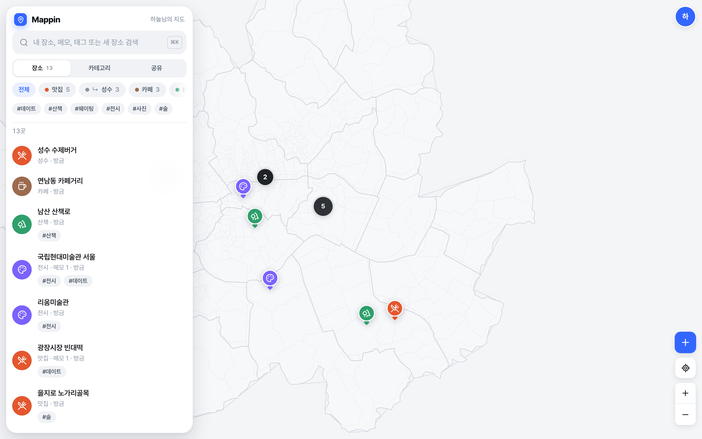

# Mappin



> 이 저장소는 Mappin 전용입니다. 브랜치 `bgplay-main`, `ccr-94ee0a85-9h95lk`, `ccr-12767b92-qswouo`, `ccr-482bdde4-1bb1la`는 다른 프로젝트의 흔적으로 **삭제 대상**입니다 (그 밖의 `ccr-*` 브랜치는 Mappin 작업 브랜치일 수 있으니 이름으로 구분하세요) → [docs/09](docs/09-repo-housekeeping.md)

내가 저장한 장소(POI)와 그곳에 쌓인 기록(메모 히스토리, 태그, 아이콘, 카테고리)을 지도 위에서 다시 보고, 지인과 공유하는 서비스.
**웹 우선**으로 만들고, 같은 API와 도메인 모델로 **iOS·Android**까지 확장한다.

## 문서

| # | 문서 | 내용 |
|---|---|---|
| 01 | [서비스 기획](docs/01-product-plan.md) | 시나리오, 기능 우선순위(P0/P1/P2), 도메인 모델, 카테고리·태그·메모 히스토리 설계, 공유 모델, 화면 구성 |
| 02 | [지도 공급자 조사와 결정](docs/02-map-provider-research.md) | Kakao / Naver / Google / MapLibre+OSM / 브이월드 / Apple 비교, 약관에 맞춘 저장 정책, 결정 게이트 |
| 03 | [아키텍처](docs/03-architecture.md) | 기술 스택, 모노레포, 지도 어댑터, 인증, 공유 권한, 동기화, 플랫폼별 접근 계획 |
| 04 | [API 개요](docs/04-api.md) | 공통 규약, 엔드포인트 요약, 핵심 흐름, 클라이언트 생성 |
| 05 | [로드맵·법규·리스크](docs/05-roadmap-and-compliance.md) | 단계별 일정, 위치정보법 등 체크리스트, 리스크 대응 |
| 06 | [디자인 시스템](docs/06-design-system.md) | "조용한 지도, 선명한 핀" — 원칙, 색·타이포·모션 토큰, 레이아웃, 컴포넌트, 접근성 |
| 07 | [P0 구현 결과](docs/07-p0-report.md) | 구현 기능, 디자인 적용, 테스트 결과(서버 23 · E2E 20), 스크린샷, 남은 한계 |
| 08 | [개별 서버에 설치하기](docs/08-self-hosting.md) | Docker Compose(PostGIS·API·웹·Caddy HTTPS) 설치, 설정, 업데이트, 백업·복원, 문제 해결 |
| 09 | [저장소 정리 기록](docs/09-repo-housekeeping.md) | 이 저장소에 남은 다른 프로젝트 브랜치(삭제 대상)와 직접 지우는 방법 |

## 계약과 뼈대

| 경로 | 설명 |
|---|---|
| [`api/openapi.yaml`](api/openapi.yaml) | **단일 API 계약** (OpenAPI 3.1, 65개 엔드포인트 — 그중 8개는 P1 예정) — 웹·RN·Swift·Kotlin 클라이언트를 모두 여기서 생성한다 |
| [`db/migrations/`](db/migrations) | PostgreSQL 16 + PostGIS 스키마 (순서대로 적용되는 SQL 마이그레이션) |
| [`packages/map-core/src/index.ts`](packages/map-core/src/index.ts) | 지도 공급자 독립 인터페이스 (`MapProvider`, `MapHandle`, `MarkerSpec`, 아이콘 결정 규칙) |

## 핵심 결정 요약

1. **데이터는 우리가 소유한다** — 좌표는 WGS84로 저장한다. 지도사 장소 ID는 참조값으로만 둔다. 공급자의 상세 정보는 저장하지 않고 실시간으로 조회한다.
2. **국내 지도는 Kakao(MVP), 대안은 Naver, 해외와 폴백은 MapLibre+OSM** — 모두 어댑터 뒤에 둔다. `/v1/map/config`로 앱을 재배포하지 않고 공급자를 바꾼다.
3. **TypeScript 단일 스택** — Fastify + PostGIS / Next.js / Expo(React Native, P1)가 `api-client`·`map-core` 패키지를 공유한다.
4. **카테고리(계층·1개) + 태그(다중·부착 시각 기록) + 메모 타임라인(리비전 보존) + 장소 이벤트 로그**
5. **공유는 장소나 카테고리 단위**로, 사용자·이메일·링크에 `viewer`/`editor` 권한을 준다. 받은 사람은 내 지도 위에 레이어로 겹쳐 본다.

## 실행

DB를 띄웁니다 (PostgreSQL 16 + PostGIS):

```bash
docker compose up -d db
```

환경변수 파일을 만듭니다:

```bash
cp .env.example .env
```

의존성 설치 후 마이그레이션을 적용합니다:

```bash
pnpm install && pnpm db:migrate
```

API(8080)와 웹(3000)을 함께 실행합니다:

```bash
pnpm dev
```

GitHub Codespaces: 저장소 페이지 → **Code → Codespaces → Create codespace** (DB·마이그레이션·서버 자동 실행)

**운영 서버 설치** (Docker, 자동 HTTPS) → [docs/08-self-hosting.md](docs/08-self-hosting.md):

```bash
DOMAIN=map.example.com ./deploy/setup.sh
```

## 구조

| 경로 | 설명 |
|---|---|
| `apps/server` | Fastify API (인증·장소·메모·태그·카테고리·공유·내보내기) + 통합 테스트 |
| `apps/web` | Next.js 웹 (지도 앱, 공유 링크 SSR 페이지) — 지도 어댑터는 `src/map/` (MapLibre·Kakao) |
| `packages/api-client` | OpenAPI에서 생성한 타입 + fetch 클라이언트 (웹·RN 공용) |
| `packages/map-core` | 지도 공급자 독립 인터페이스 |
| `scripts/e2e.mjs` | Playwright E2E (스크린샷 → `e2e-artifacts/`) |

## 검증

API 서버 통합 테스트 (PostGIS DB 필요, `TEST_DATABASE_URL`):

```bash
pnpm --filter @mappin/server test
```

브라우저 E2E (서버가 떠 있는 상태):

```bash
pnpm e2e
```

API 명세 검증:

```bash
pnpm lint:api
```
