# 07. P0 구현 결과 보고

> 기준일 2026-10-31 · 범위: [05 로드맵](05-roadmap-and-compliance.md)의 P0-0 ~ P0-3 (웹 MVP) · 디자인: [06 디자인 시스템](06-design-system.md)

## 1. 한눈에 보기

| 항목 | 결과 |
|---|---|
| API 서버 | Fastify + PostgreSQL 16/PostGIS, **엔드포인트 60여 개** 구현 (P1 범위인 친구·동기화·가져오기 제외) |
| 웹 앱 | Next.js 15 (App Router), 데스크톱 플로팅 패널 / 모바일 3단 바텀시트, 라이트·다크 |
| 지도 | `@mappin/map-core` 인터페이스 + **MapLibre 어댑터**(검증 완료) + **Kakao 어댑터**(키 필요, 미검증) |
| 서버 통합 테스트 | **22/22 통과** (`pnpm --filter @mappin/server test`, 실제 PostGIS DB 사용) |
| 브라우저 E2E | **20/20 통과**, 콘솔 오류 0건 (`pnpm e2e`, Playwright/Chromium, 데스크톱·모바일) |
| API 계약 | `api/openapi.yaml` Redocly lint 통과 → `packages/api-client` 타입 생성 |
| 실행 환경 | `docker-compose.yml`(PostGIS), GitHub Codespaces(`.devcontainer`), GitHub Actions CI |

## 2. 구현된 기능

**계정**
- 이메일 가입·로그인과 필수 약관 동의(이용약관·개인정보·위치기반서비스·만 14세)
- 이메일 인증, 비밀번호 재설정
- 로그아웃, 회원 탈퇴(7일 유예 후 영구 삭제)
- 토큰 보안
  - Refresh 토큰은 사용할 때마다 교체하고, 이미 쓴 토큰이 다시 쓰이면 탈취로 보고 세션 전체를 폐기합니다.
  - 웹에서는 refresh 토큰을 HttpOnly 쿠키에 두고, 갱신할 때 CSRF 헤더를 요구합니다.
- 소셜 로그인(Kakao/Google): 서버 검증 로직까지 구현했고, 클라이언트 키를 설정하면 활성화됩니다.

**장소(POI)**
- 만드는 방법: 지도 우클릭(모바일은 길게 누르기), `+` 버튼(N키), 검색 결과에서 저장
- 핀 위치 맞추기: 지도를 움직여 가운데 핀에 맞춥니다. 핀은 선택한 아이콘과 색으로 바로 미리 보입니다.
- 저장되는 정보: 이름, 위치(WGS84), 주소(역지오코딩), 아이콘 24종, 10색, 카테고리, 태그, 첫 메모
- 수정: 낙관적 잠금(`If-Match`)을 써서 동시에 고쳐도 덮어쓰기가 일어나지 않습니다.
- 삭제: 휴지통으로 보내고 되돌리기를 지원합니다.
- **메모 타임라인과 수정 이력**: 메모가 시간순으로 쌓이고, 고칠 때마다 이전 내용이 보존됩니다. "나만 보기" 메모도 쓸 수 있어요.
- **장소 이벤트 히스토리**: 저장·이동·아이콘·카테고리·태그 변경과 태그를 붙인 시각이 메모와 함께 하나의 타임라인으로 보입니다.

**분류·탐색**
- 계층 카테고리: 5단계까지, 상위 카테고리의 아이콘·색을 이어받고, 순환 이동을 막습니다. 삭제할 때 안에 있던 장소를 어떻게 처리할지 고를 수 있습니다.
- 카테고리·태그 칩 필터: 카테고리는 하위까지 포함하고, 태그는 "하나라도 / 모두" 조건을 지원합니다.
- 키워드 검색: 이름·주소·메모·태그에서 찾습니다.
- 클러스터링: 클라이언트에서 supercluster로 묶고, 서버의 `/map/clusters`도 준비해 두었습니다.

**공유**
- 장소나 카테고리 단위로 이메일 초대. 가입하지 않은 사람에게 보내도 그 이메일로 가입하면 자동으로 연결됩니다.
- 권한은 `viewer`와 `editor` 두 가지입니다.
- 받은 사람은 수락한 뒤 자기 지도에 레이어로 겹쳐 보고, 레이어를 켜고 끄거나 내 장소로 복사할 수 있습니다.
- 링크 공유: 로그인 없이 SSR 페이지로 열리고 OG 태그를 지원합니다. 비공개 메모는 제외되고, 링크를 재발급하거나 회수할 수 있습니다.

**기타**
- 내보내기: GeoJSON, CSV, GPX, KML
- 키보드: ⌘K 검색, N 새 장소, Esc 뒤로
- 위치정보 수집·제공 사실을 `location_access_logs`에 기록합니다.

## 3. 디자인 적용 ("조용한 지도, 선명한 핀")

| 원칙 | 적용 |
|---|---|
| 조용한 배경지도 | 회색조 기본지도(OpenFreeMap Positron/Dark)를 써서 색은 핀과 카테고리에만 씁니다 |
| 지도 우선 레이아웃 | 데스크톱은 384px 플로팅 패널, 모바일은 peek/half/full 스냅과 속도 감지가 있는 바텀시트입니다 |
| 절제된 유리 재질 | 컨트롤은 반투명 blur를 씁니다. 패널은 핀이 비쳐 얼룩지지 않도록 95% 불투명으로 했습니다(검수 중 수정). `prefers-reduced-transparency`이면 불투명 면으로 바꿉니다 |
| 읽히는 핀 | 34px 원형 핀 + Lucide 글리프 + 흰 링 + 꼬리를 씁니다. 선택하면 scale 1.18과 강조 링이 붙고, 공유받은 핀에는 배지가 붙습니다. 클러스터는 잉크색 원에 숫자를 씁니다 |
| 한글 타이포 | Pretendard Variable을 자체 호스팅하고, 숫자는 tabular-nums를 씁니다 |
| 해요체 마이크로카피 | "저장했어요", "아직 저장한 장소가 없어요", 되돌리기 토스트 |

스크린샷(E2E 실행 중 자동 캡처, 오프라인 데모 지도 사용):

| 데스크톱 목록 | 장소 상세·타임라인 | 메모 수정 이력 |
|---|---|---|
| 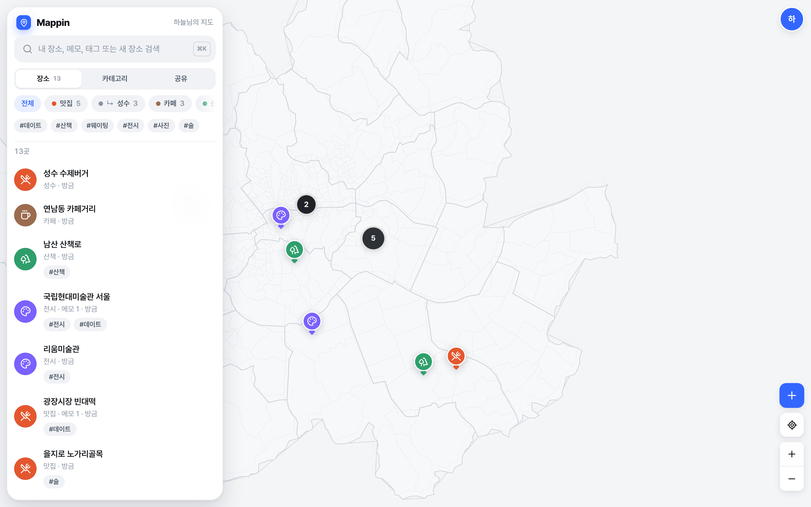 | 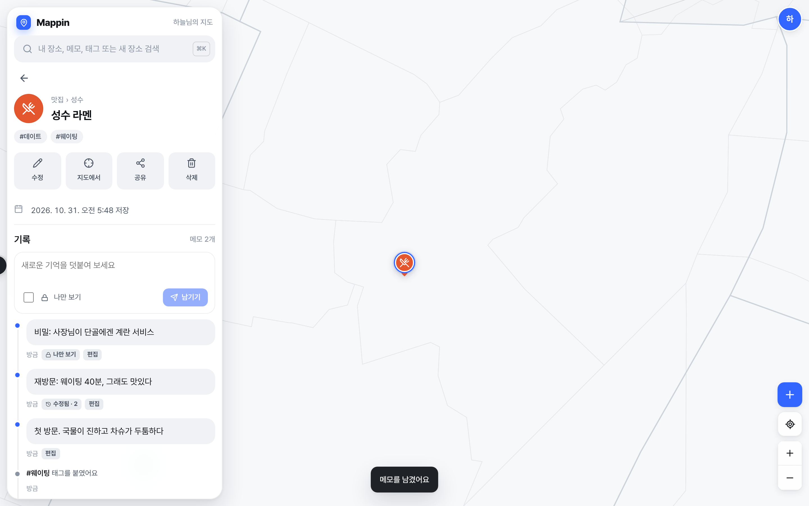 | 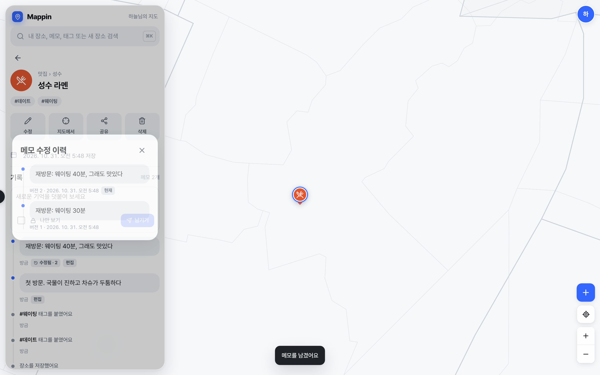 |
| **새 장소 저장** | **공유 다이얼로그** | **링크 공유 페이지(비로그인)** |
| 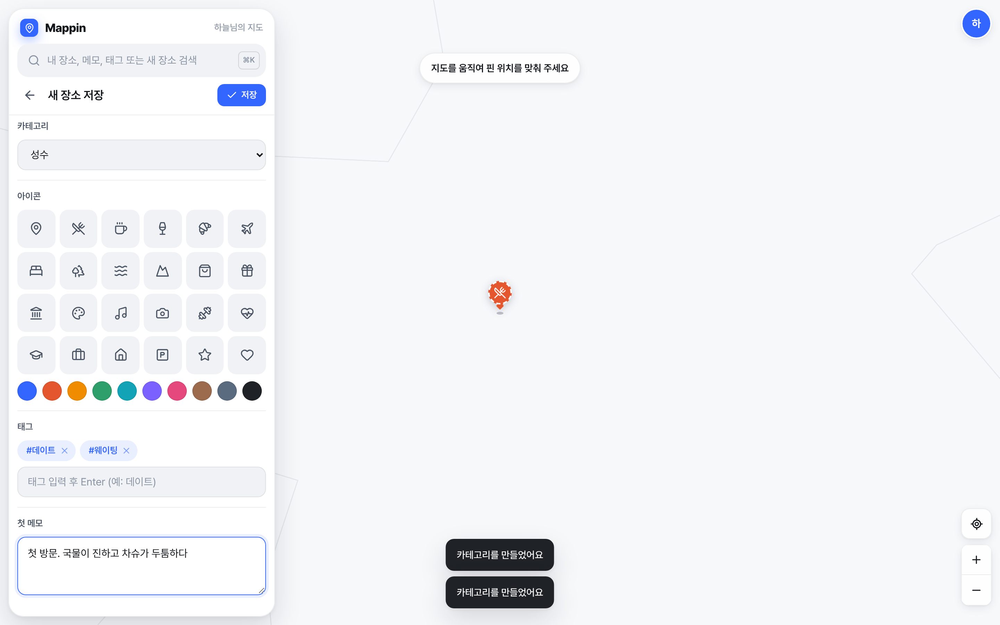 | 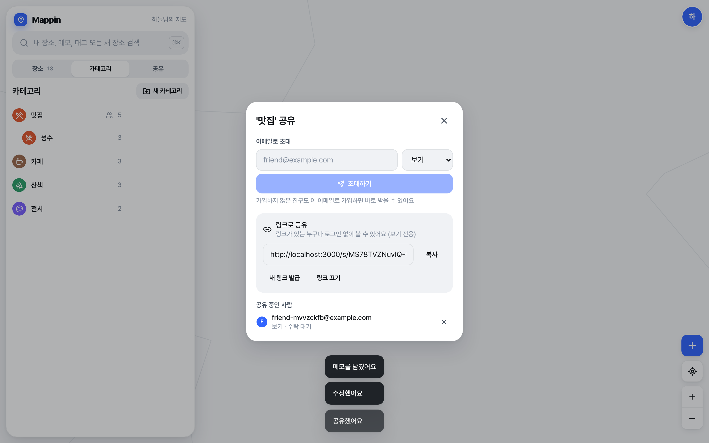 | 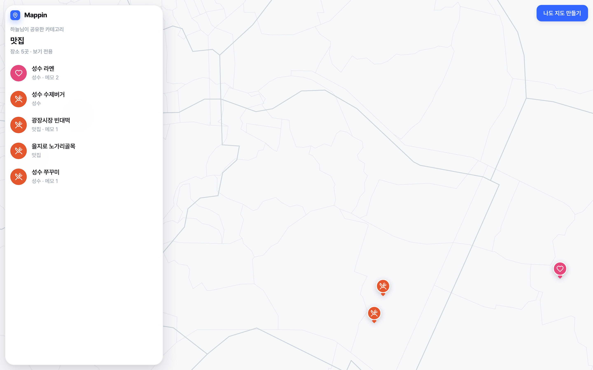 |
| **친구 화면(공유 레이어)** | **다크 모드** | **로그인** |
| 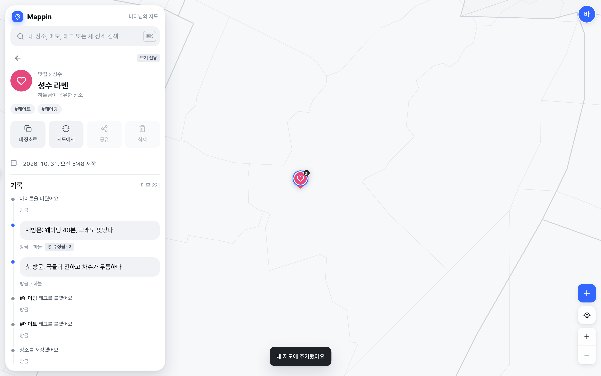 | 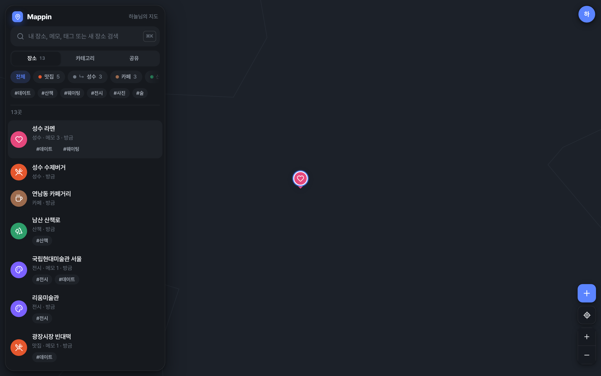 | 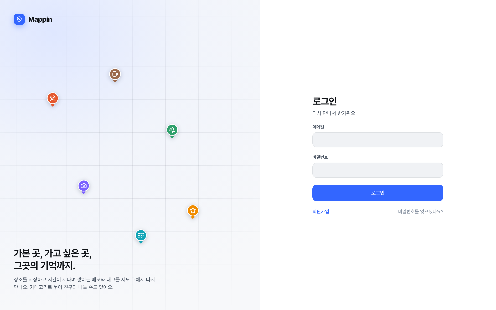 |

| 모바일 목록 | 모바일 상세 |
|---|---|
| 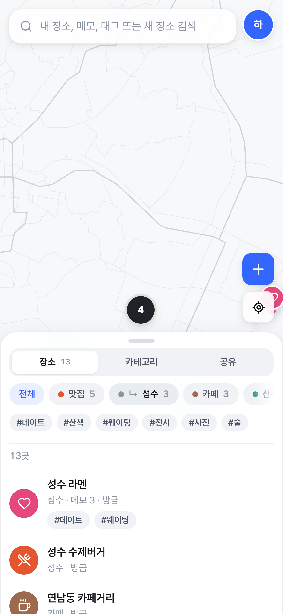 | 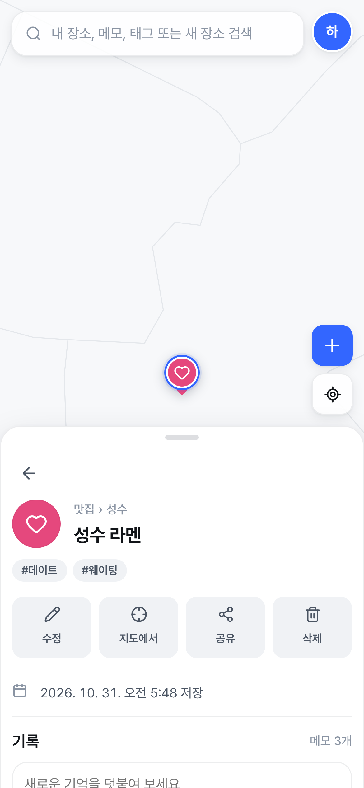 |

## 4. 테스트 내역

**서버 통합 테스트 (22개)**
- 인증: 가입·로그인, 약관과 비밀번호 검증, refresh 토큰 교체와 재사용 탐지, 웹 쿠키 + CSRF, 로그아웃 즉시 무효화, 메일 토큰으로 인증·재설정, 소셜 로그인 흐름
- 장소: 생성(멱등키 재시도), 지도 범위·반경·카테고리 하위·태그 any/all·키워드·페이지네이션, 낙관적 잠금 428/412, 이벤트 기록, 메모 리비전, 태그 부착의 멱등성
- 카테고리: 트리와 개수, 순환 이동 방지, 삭제 정책
- 휴지통·일괄 작업, 검색 결과의 "이미 저장함" 표시, 지도 설정과 서버 클러스터, 내보내기
- 공유: 수락 전후의 노출, viewer 403, editor 수정, 비공개 메모 제외, 링크 재발급·회수(404/410), 남의 장소 공유 차단
- 회원 탈퇴: 세션과 공유 무효화

**브라우저 E2E (20개, Playwright)**
- 로그인 → 약관 미동의 차단 → 가입
- 카테고리 생성(아이콘·색) → 지도 우클릭으로 장소 저장(태그·메모)
- 시드 12곳 → 마커·클러스터 → 카테고리·태그 필터 → 메모 검색
- 메모 추가·수정·이력 → 비공개 메모 → 아이콘 수정(수정하지 않은 필드로 이벤트가 생기지 않는지 확인)
- 카테고리 링크·이메일 공유 → 비로그인 링크 열람(비공개 메모 숨김 확인) → 친구 가입·수락·공유 레이어
- 다크 모드 → 모바일(390×844) 바텀시트·상세, 가로 스크롤 없음 → 로그아웃

**검수 중 발견해 고친 것**
- 패널 헤더가 넘침(grid `minmax(0,1fr)`)
- 패널 뒤로 핀이 비쳐 얼룩짐(패널 불투명도 상향)
- 테마를 바꿔도 메뉴가 닫히지 않음
- 비로그인 상태에서 불필요한 401 요청(세션 힌트 쿠키로 해결)
- 편집하지 않은 필드로 "정보를 수정했어요" 이벤트가 기록됨
- 미리보기 핀이 선택한 아이콘을 반영하지 않음
- 폼 헤더 고정
- 하위 카테고리의 아이콘 상속(DB 함수 `category_icon`)

## 5. 이 환경의 한계와 확인이 필요한 것

| 항목 | 상태 |
|---|---|
| 실제 지도 타일 | 이 클라우드 환경은 타일 서버(OpenFreeMap)가 네트워크 정책으로 막혀 있어, 스크린샷은 서울 행정경계로 만든 **오프라인 데모 지도**(`MAP_STYLE=demo`)로 찍었습니다. 기본 설정(`openfreemap`)으로 실행하면 실제 지도가 나옵니다 |
| 외부 장소 검색 | Nominatim과 Kakao Local에 연결할 수 없어 UI의 "새 장소 찾기"는 이 환경에서 오류 메시지를 보여줍니다. 서버 로직은 가짜 공급자로 테스트했습니다. `KAKAO_REST_KEY`를 설정하면 Kakao로 동작합니다 |
| Kakao 지도 어댑터 | 구현은 했지만 키와 네트워크가 없어 **실제 SDK로 검증하지 못했습니다**. 키를 발급받은 뒤 확인이 필요합니다. SDK 로딩에 실패하면 MapLibre로 자동 전환됩니다 |
| 소셜 로그인 | 서버 검증은 테스트했지만, 클라이언트 버튼과 OAuth 앱 등록은 키를 받은 뒤 붙여야 합니다 |
| 메일 발송 | 개발용 `MemoryMailer`(로그 출력)만 있습니다. 운영에서는 SES 같은 서비스를 연결해야 합니다 |
| 레이트 리밋 | 아직 없습니다. 배포 전에 `/geo/*`와 `/auth/*`에 적용해야 합니다 |

## 6. 실행 방법

로컬에서 실행하려면:

```bash
docker compose up -d db
```

```bash
cp .env.example .env
```

```bash
pnpm install && pnpm db:migrate
```

```bash
pnpm dev
```

`http://localhost:3000`이 열립니다. 테스트는 `pnpm --filter @mappin/server test`(TEST_DATABASE_URL 필요)와 `pnpm e2e`(서버를 띄운 상태)로 돌립니다.

GitHub Codespaces를 쓰려면 저장소 페이지에서 **Code → Codespaces → Create codespace**를 누르세요. DB, 마이그레이션, 개발 서버가 자동으로 뜨고 3000번 포트가 브라우저로 열립니다.
